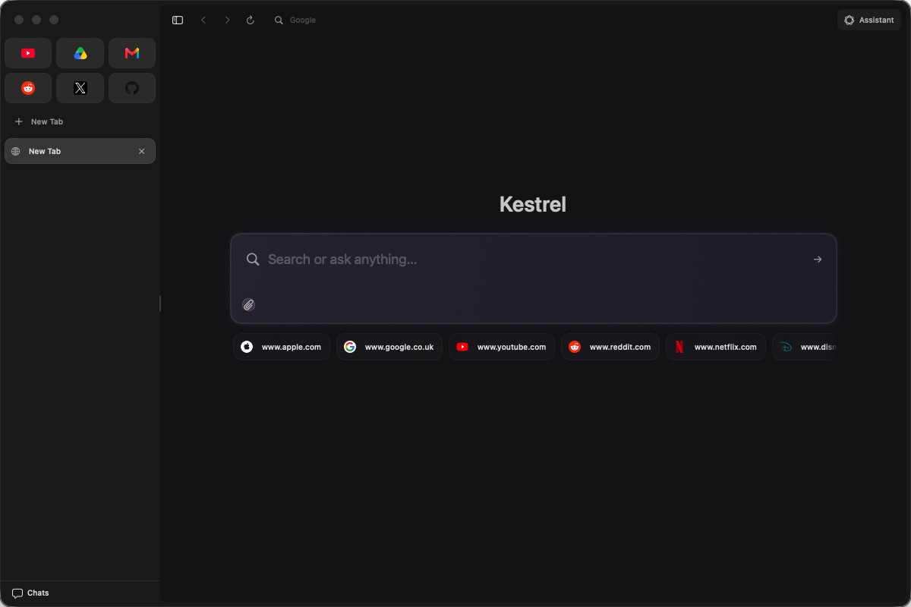
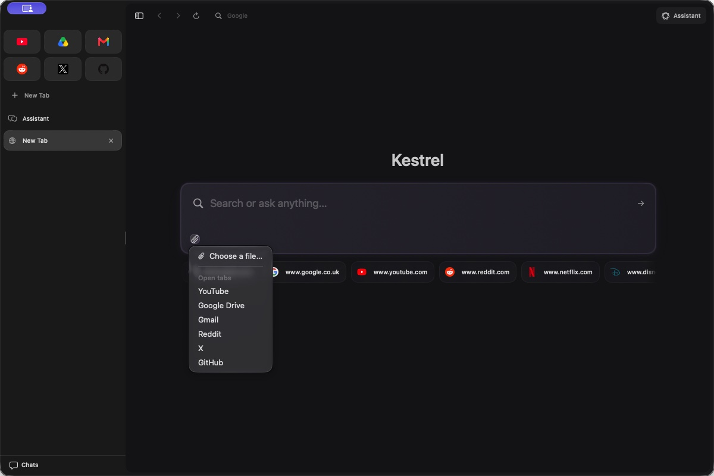
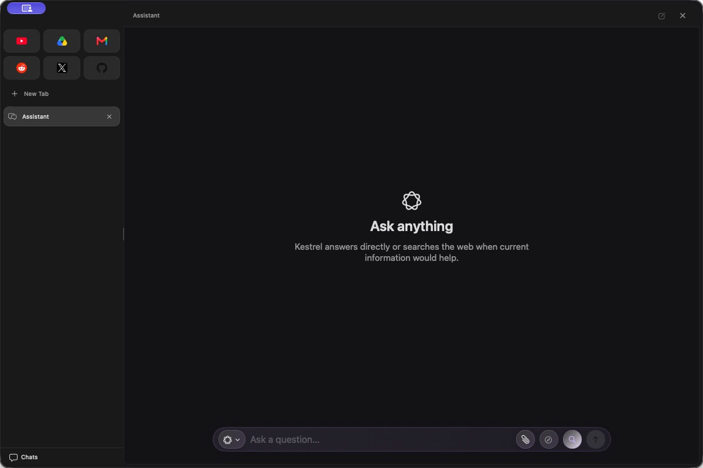
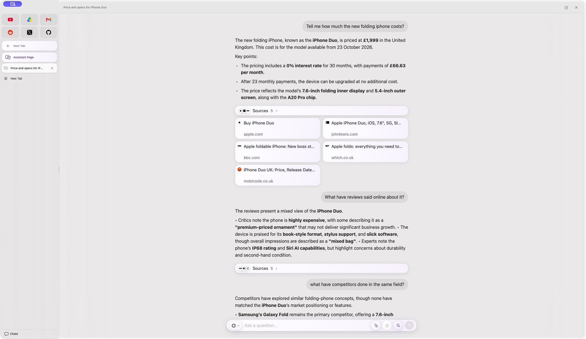

# Kestrel

**Kestrel Browser 1.0** is available from the [public release page](https://github.com/shay2000/Kestrel-Browser/releases/latest). Kestrel checks for updates automatically and also provides **Kestrel → Check for Updates…**. Updates are downloaded and installed by Sparkle after the user accepts the update.

A native macOS browser starting point for **Kestrel**, built with SwiftUI and Apple's `WKWebView` rather than bundling Chromium. The repository and Swift module retain the `KestrelWebKit` implementation name, but the shipped application, bundle and executable are called **Kestrel**.

## Why WebKit for the Mac build?

WebKit is a sensible default for a Mac-first browser shell:

- it ships with macOS, so Kestrel does not need to download or package a separate browser engine;
- it integrates naturally with SwiftUI, AppKit, macOS windowing, sandboxing and system privacy controls;
- the application bundle and update path stay smaller than an embedded Chromium runtime;
- Apple maintains the engine and its security updates through the operating system.

The trade-off is that WebKit is Apple-platform technology. If Kestrel later needs first-class Windows or Linux support, the browser-engine boundary should be kept clean so another implementation can be added without rewriting the UI.

## Kestrel branding

 

The application uses the approved smooth kestrel artwork from the supplied reference: white on purple for the bundled app icon, and lavender on charcoal for the running app's dark appearance. Finder, the Xcode asset catalogue and the SwiftPM `.icns` use the purple icon; the Dock and About panel follow Kestrel's System / Light / Dark setting. The canonical SVGs and regeneration instructions are in [`resources/branding`](resources/branding/README.md).

The previous blue-and-gold icon set is preserved byte for byte in [`historic-icons`](historic-icons/README.md), with its Dia-elium source attribution and SHA-256 checksums.

The visible application name is **Kestrel**. `KestrelWebKit` remains the internal SwiftPM target/module and Xcode target name so existing source imports stay stable.

## Screenshots

| Unified New Tab page | Attach menu | Assistant page |
| --- | --- | --- |
|  |  |  |

Assistant search sources start collapsed. Open a source row to see the raised lavender cards, favicons and consistent rounded corners:



The tab rail keeps a single, compact **+ New Tab** action, matching the original rail styling. Clicking it opens a fresh New Tab dashboard. ⌘T shows or hides the floating search bar over the current page; on a blank tab it keeps the dashboard visible. Press ⌘Return in the bar to ask AI, then the composer hands off to the Assistant page or sidebar chosen in Settings. Suggestions slide below the full composer with a small gap, keeping the bar and results visually distinct.

Settings → **Shortcuts** groups actions by category and lets you filter by name or group, then record custom keys for tab actions, both split directions, navigation, zoom and Assistant actions. Click a binding and press your preferred combination with Command, Option or Control; arrow keys are supported. Duplicate bindings and reserved editing/app commands show an explanation. Changes are saved immediately, with individual and full reset controls. Existing Assistant bindings are retained. The shortcuts below are the defaults.

Settings uses a compact category sidebar, aligned controls, persistent field labels and shared 14-point labels / 12-point supporting text. Soft section highlights and shallow shadows adapt to Light and Dark appearance. Category changes fade briefly and respect Reduce Motion; each category opens at the top. Assistant model selection stays visible, with executable, argument and endpoint fields under **Connection details**.

Primary sidebar and address-bar labels share a 14-point system font, with 12-point supporting labels. The window uses one connected glass backing, with evenly inset page cards and a narrow split seam. The full Assistant page uses a solid header and a composer with the controls below the text field; controls wrap onto a second row in narrow panes. Address typing stays separate from the loaded page: Up/Down chooses a dropdown row and Return activates that row; inline completion selects only the suggested suffix for replacement, acceptance or deletion.

The Assistant page and sidebar accept the same supported files as New Tab. An unsent question and its attached files survive hiding the sidebar or switching to the Assistant page; New Chat clears the draft. File chips use official document-type marks at a consistent size; provider and model limits are shown before a model change would leave too many files attached. Browser, tab, split-view, Assistant and settings controls provide short hover descriptions of their actions. In Settings → General, choose whether New Tab AI replies open the full Assistant page (the default) or start in the sidebar, and choose System, Light or Dark appearance. The configured Assistant shortcut (⌘E by default) continues to toggle the sidebar beside a webpage.

## What is here

The current shell includes:

- a native SwiftUI macOS window;
- a Dia-inspired 40-point toolbar that follows the page background, a compact vertical tab rail with site favicons, and a right-side assistant panel. Both sidebars have accessible drag handles and remember their widths; their contents adapt as they are resized. Kestrel locally samples only the visible 30-point strips at each page edge (and refreshes them when scrolling) to create a soft page-colour reflection at the page edges and sidebar seam, while the toolbar uses the page’s native background colour. Assistant web searches add a softer temporary purple edge glow. The layout compacts for half-screen windows. Clear Liquid Glass is reserved for secondary surfaces, with a lighter native material fallback on the macOS 14 deployment baseline;
- a `WKWebView`-backed browser surface behind `BrowserStore` and `BrowserView`;
- persistent pinned shortcuts with complete rectangular favicon tiles and a site-coloured selected outline. Drag to reorder within each tab group, or use Move Earlier/Later in the context menu. Tabs can be renamed, duplicated and unpinned; closing a pinned page unloads it while retaining its saved destination. Reset to Pinned Page returns to that destination. Up to 48 pins are saved locally and restored lazily. ⌘⇧T reopens recently closed ordinary tabs within the current session; ⌃⌘S toggles the tab rail;
- a vertical tab strip (`TabStore` and the pure `TabCollection`) that keeps one live web view per tab, so switching preserves the page. A split view uses two rounded cards, each with its own navigation, favicon, editable address and close control; the shared toolbar disappears and a neutral outline marks the focused pane. The tabs share one two-part sidebar row. Drag the divider to resize them, or double-click it for equal widths. The pair and its width survive switching to another tab during the session. Right-click a tab to choose **Open in Split View With**, or **Separate Split View** to keep both tabs independently; closing one pane expands the survivor. Narrow panes put secondary controls in a menu so the address stays readable. ⌘← and ⌘→ split the current view; when a non-empty New Tab query is present, they search it in the requested pane and keep the current page opposite it. Repeating the shortcut replaces that pane. With no query, the selected tab is placed in that pane;
- an address bar that accepts URLs or search text, with Google, DuckDuckGo or Bing selectable as the default engine. While typing, it immediately matches local bookmarks, Kestrel's own tabs and up to 50 locally retained search terms, then adds suggestions from the selected engine after a short pause; address-shaped input is excluded from remote suggestions and search history. Search history can be cleared in Settings. Matching recent searches and known sites complete inline with a selected suffix; typing replaces the suffix, Right/Tab accepts it and Backspace/Escape dismisses it. Remote suggestions can also complete a matching prefix. The dropdown starts below the complete composer with an 8-point gap and scrolls within the remaining window height; arrow-key selection scrolls into view. ⌘T overlays a centred search field on the current page, with bookmarks underneath until typing begins; the bookmark shelf fades away without shifting the field. ⌘↩ routes the query to Assistant. Typing an allow-listed shortcut such as `maps` then pressing Tab switches to that search mode. Backspace in the empty field or at the start of its query exits the mode, as does Escape; deleting the whole query also restores ordinary search. Bang forms such as `!maps query` are also supported, and search history keeps only the query after the bang, because the bang is how the search was asked for rather than part of what was searched for;
- a Dia-inspired new tab page rather than a blank pane. Launching Kestrel, or pressing ⌘T on an empty tab, shows a defined **Search or ask anything…** composer on a distinct canvas. Its position stays fixed when typing begins. Underneath it, **Add files** takes an image, PDF, Word, Excel, PowerPoint or text file and **Add tab** attaches another open tab's visible text, so a question can be asked against material rather than only typed. The open panel offers only types Kestrel can actually send, so an unsupported file cannot be chosen in the first place. Word, Excel and PowerPoint documents are read locally by extracting their text, which means they work with every provider rather than only a hosted one; images and PDFs travel as bytes and are refused with an explanation for a provider that cannot read them. Attachments appear as removable chips, are bounded per item and in total, and are sent only inside the request the user already made. A question carrying attachments goes to Assistant rather than to a search-results page, because attached material only means something to a model. Clicking the page behind the new tab page puts it away;
- back, forward, reload and stop controls, plus back/forward swipe gestures. Chrome-style shortcuts use Control+Command so they remain separate from Kestrel's explicit commands: ⌃⌘L for the address field, ⌃⌘F to find on the page, ⌃⌘R to reload, ⌃⌘[ and ⌃⌘] for history, ⌃⌘+ / ⌃⌘− / ⌃⌘0 for zoom, ⌃⌘1–⌃⌘9 for tab selection and ⌃⌘⌥←/→ for adjacent tabs. Kestrel keeps ⌘T, ⌘W and ⇧⌘T for new, close and reopen-tab actions;
- page-title and loading-state updates;
- a dedicated WebKit configuration boundary with a shared process pool;
- Safari compatibility tokens appended to WebKit's default user agent, avoiding Google's unstyled fallback while keeping WebKit as the browser engine;
- an Assistant control that opens the chat page from an empty New Tab and toggles the sidebar beside a webpage, preserving the current conversation and draft. The configured shortcut uses the same routing. The sidebar includes official provider marks, a lightweight search composer, a page-focused empty state that invites you to ask about the current page, and a local history menu for reopening or deleting previous chats. The assistant page has its own larger reading scale, independent of the current website: it answers and searches from the question asked, while the sidebar beside a webpage can read that page. Its composer matches the New Tab file attachment support and uses a paperclip action with document-type thumbnails. An **Agent mode** button in both composers arms page control: it is off by default, writes nothing to the transcript, and lets the next message operate the current page without a second confirmation, while low-risk navigation still follows the safe-browsing preference and mutating actions stay approval-gated. Assistant replies always write in British English unless the user explicitly asks for another language or spelling, and render Markdown headings, emphasis, lists, quotes and code as spaced blocks, with long unformatted responses broken into readable paragraphs; prompts ask models for concise structure instead of dense dumps. Sidebar labels stay on one line and truncate where needed. Transcript history stores only user/assistant messages (not page snapshots or browser-action approvals/results) and is bounded by count and size. A fast on-device intent classifier routes ordinary answers and web searches, recognises image-search requests and opens the selected engine's image-results page using the extracted subject, then confirms where results opened without pretending to analyse image pixels. Concrete website-operation requests override a weak classifier decision and ask before switching to the cursor assistant; declining takes the ordinary search route. A question that only live data can answer — a price, cost, stock level or forecast — also overrides a weak classifier decision and searches, because a small model does not know today's price, while technical "cost" questions and arithmetic stay with the model. A conversation that has searched keeps searching on its follow-ups, unless the follow-up asks for something the model can produce itself or web search is disabled in Settings. Apple On-Device uses greedy, short-output routing plus distinct temperature and response-token budgets for answers, search summaries and browser operations; for a substantive answer it drafts several candidate answers at different temperatures and merges them into one final reply, so it does not settle for a single line, and it names each chat once, after the first answer, from the question and what the answer covered, cleaning a trailing full stop off the title. Search progress is shown in the conversation and by the page-edge glow. Web search is on by default and can be disabled only in Settings → Assistant → Allow web search. Both composers keep the model picker above the message box and attachments, Agent mode and Send aligned on one compact row;
- assistant providers for Apple On-Device (Foundation Models), Codex using an existing ChatGPT sign-in, local Kilo CLI, and keyed HTTPS services. Each keyed provider has its own Keychain account and environment-variable name. Model lists are fetched where the provider permits it; packaged Codex uses its documented app-server `model/list` (developer CLI fallback uses `codex debug models`), and models from OpenRouter's free and automatic routers appear first. The composer’s model pill shows the selected model and opens a native popup anchored to its button, with separate provider and model sections. Provider switches discard stale catalogue replies, and list failures keep the current selection visible with an explanation and reload control. The picker offers plain-language **Free**, **Cheap**, **Fast** and **Quality** quick picks, backed by concrete provider model IDs, with the full searchable catalogue one disclosure away. Gemini starts at `gemini-3.8-flash`; the legacy 2.5 Flash default is migrated because Google limits 2.5 access to existing users. When context size is known, the attachment allowance adjusts with it; Apple On-Device uses a smaller limit. Changing to a lower limit warns first and keeps every attachment, while changing to a higher limit raises the allowance. Catalogue browsing does not read saved API keys; providers that require authentication keep their quick picks available when a live list cannot load. Mistral's mixed catalogue includes chat, OCR, audio, embedding and moderation models, so Kestrel offers only chat-capable (`completion_chat`) models. CLI arguments are passed directly, never through a shell. Codex runs with a fixed argument template that reads its JSON event stream and shows only the assistant's prose, so usage-limit, authentication, sandbox and turn failures appear as readable messages instead of raw protocol JSON. Kestrel remains sandboxed and does not ask Finder for access to external executables; execution of an installed host CLI must be verified against the signed app's sandbox permissions;
- an optional **Exa** web-search connector. When enabled with an API key in Settings, an Assistant web search is answered by Exa's search API instead of by driving a search-results page, which keeps the request to one HTTPS call and preserves each result as its own labelled, bounded citation. An explicitly web-researching **Agent mode** request can use the same connector as read-only evidence while remaining bound to its original tab; only the derived query goes to Exa, page text and browser state stay local, and the retrieval consumes none of the bounded page-action slots. The same bounded results also appear under the answer as a collapsed **Sources** button previewing three favicons, which opens into a grid of equal-sized cards and folds again when the next question is asked; a card opens the page in a background tab so the chat stays in view, and the source lists are archived with the conversation so they are still there when a chat is reopened. A card is only ever shown for a source that was actually in the request, its icon comes from the result's own origin rather than a third-party favicon service, and browser-scraped searches carry no cards. Sources are not also hyperlinked inside the answer prose, so the cards are the one clickable surface. It is off by default; enabling it without an accessible key reports that specific error rather than silently switching services. Redirects are refused across hosts so the API key cannot leak, and HTTP downgrades are rejected;
- a coarse, private **region hint** in assistant requests. With **Include my region in requests** on (the default), Kestrel adds the country and time zone read from this Mac's own locale so an answer about a price, unit or availability can be locally relevant, and it qualifies a price, shopping or local search before the search runs so results match the user's country instead of defaulting to the US. It is assembled on-device, never a precise location, and never a reason to ask macOS for a location permission or to make a network request to find out where the user is; turning the setting off removes it entirely;
- an allow-listed browser operator (`BrowserAction`) with an “Auto-approve safe browsing” setting, on by default. Kestrel always asks before starting cursor assistance; after the user chooses it, the setting automatically continues URL navigation, back/forward, find-on-page and the constrained same-origin GET site-search action. Turn the setting off to review each navigation. Agent mode automatically handles allow-listed product choices and basket controls; unrecognised or consequential clicks require review, and checkout/purchase proposals stop. MCP-requested actions always use the approval UI. A visible app-rendered cursor and highlighted target show where click/search actions are aimed, with a prominent Stop control; this is not OS-level mouse injection. `click_text` requires an exact visible label. Click and search targets must remain enabled, non-inert, uncovered and unchanged while the cursor moves. `search_page` requires one labelled visible search field and a same-origin GET form, including its submitter overrides. It navigates using encoded plain HTML controls without invoking the page’s input/click/submit/formdata handlers; password/file controls and JavaScript-only searches are excluded. JavaScript-only forms need a separately approved interaction. The model cannot express arbitrary scripts, selectors or commands. Each successful action is followed by a fresh bounded page snapshot on the initiating tab. Agent mode has a twelve-action budget and can continue there while another tab is selected; failure, cancellation, declined approval and no-progress loops stop it;
- browser-task reliability: unchanged-state checks cover the whole bounded task, so alternating actions cannot evade the loop guard. On reaching the limit or an action failure, operation stops and one summary-only request reports supported findings and gaps. Bounded evidence from visited pages stays in memory for the task, never in the transcript archive. Find-on-page returns surrounding text from deeper in a long document; page snapshots capture text, controls and metadata together and clip text before it crosses the WebKit bridge. Rendered text search fields remain discoverable after scrolling, disabled/inert controls are excluded, and links whose query or fragment was removed use their exact label rather than a misleading shortened destination. History navigation, reloads and click/search destinations wait for navigation before the next page read;
- an Apple On-Device browsing planner tuned for the local model: compact current-state prompts omit stale action replies, greedy guided generation restricts the next step to actions appropriate to the current page, and literal find/site-search commands avoid an unnecessary planning inference. Product discovery inspects relevant observed links instead of searching for descriptive phrases literally, then asks about ambiguous preferences. Control hints prefer accessible labels and rank relevant destinations within their existing budget. Long real pages are reduced to overlapping rendered-text excerpts ranked against the user’s question, with exact dotted identifiers receiving priority over navigation chrome. Factual answers require supported evidence; numbers and dates must occur in the chosen quote, and two-part date/comparison questions must answer both named parts. A rejected decision gets at most one correction. This tunes prompting and orchestration, not Apple’s model weights. The operator keeps all existing approval and execution checks;
- bounded, redacted page context (`PageContext`, `Redaction`) and Keychain-backed API keys on macOS (`Secrets`). Assistant requests automatically include the active page's visible text when it can be read; web-search requests also include visible search results when available. Kestrel selects the text budget from the active provider and model, with conservative fallbacks for custom model IDs and a hard character ceiling. Credential-shaped strings are redacted on a best-effort basis, but visible secrets can still be missed and shared with the selected provider. Cookies, storage and hidden form values are not captured.
- a configurable Assistant shortcut, defaulting to ⌘ E, and a local opt-in MCP connection for coding agents;

Provider marks and their official sources are recorded in [`PROVIDER_MARKS.md`](PROVIDER_MARKS.md). The asset catalogue is compiled in the Xcode app and as a SwiftPM resource bundle; `build.sh` copies that bundle into the local app. If this managed workspace adds Finder metadata to `.build`, set `KESTREL_SWIFTPM_BUILD_DIR` to a writable temporary path when running the script.

Extension support is deliberately honest and deliberately narrow. The app targets macOS 14, where WebKit has no public extension API. On macOS 15.4 and later a small `BrowserExtensionHost` owns one `WKWebExtensionController` and uses its configured web-view configuration as the basis for every tab, so loaded extension content scripts can attach. The host can validate a local unpacked WebExtension directory or standard ZIP archive, surface manifest errors, and stage requested permissions. Kestrel Settings shows the extension name and version, warnings, and every requested API permission and host pattern; every checkbox starts off, and nothing loads until you press Approve. Chromium-origin WebExtensions may work when they use APIs supported by WebKit. The Extensions menu toggle controls only Kestrel's own command menu; it does not change the macOS menu bar.

Apple documents `WKWebExtension` resources as either a directory containing `manifest.json` or a ZIP archive; Kestrel therefore imports those forms, not Chrome `.crx` packages. Chrome-origin extensions can work when they stay within WebKit's supported WebExtension APIs. This is not full Chrome compatibility: Chrome-only APIs and a Chromium runtime are not included. Kestrel's import and permission-approval boundary must remain explicit.

## Import browser bookmarks

In Settings → General → Browser data, choose a Safari `Bookmarks.plist`, Chrome profile `Bookmarks` JSON file, or standard bookmarks HTML export (including Safari, Chrome, Firefox and Edge). The picker grants access only to the file you select. Kestrel imports deduplicated HTTP(S) bookmarks and shows them below the idle New Tab search field. Passwords, cookies, browsing history and other profile databases are not read or imported. Separately, searches typed into Kestrel are retained locally (up to 50) for suggestions and can be cleared from Settings.

No Chromium, Electron or third-party browser engine is included.

## Connect a coding agent

Kestrel can expose a small MCP server to local coding agents such as Codex. It is off by default and binds only to `127.0.0.1`. At launch, the listener stays paused without reading its Keychain token, even if enabled in saved settings. Choose **Connect Codex** for each session; this explicit action may request Keychain access. Opening Settings does not read saved provider keys, and routine provider lookups request non-interactive access. **Connect Codex** starts the listener and adds or updates only Kestrel's marked entry in `~/.codex/config.toml`; restart Codex once to load it. Kestrel uses a narrow home-relative sandbox exception for that one file, rejects symbolic links or conflicting/edited entries, and does not read Codex login data. The config endpoint contains the random token stored in Keychain, so anyone who can read the Codex config can use Kestrel's local endpoint: treat the file as sensitive. Disconnect removes only Kestrel's exact managed block. If automatic setup is unavailable, Settings also offers a copyable endpoint/CLI command and a local MCP handshake test.

The endpoint exposes an allow-listed browser-action request tool. Kestrel shows requested page-changing actions in the Assistant sidebar and runs none until the user approves them. Sharing the active tab's title/address and allowing bounded, best-effort-redacted visible page text are separate Settings permissions and both start off. The copied endpoint URL contains the access token, so treat the URL and Codex's MCP configuration as credentials. Turning the server off stops the listener; it does not remove an MCP entry already added to Codex CLI.

Read tools advertise MCP read-only annotations so Codex can distinguish them from action requests. An action request returns a request ID, not a completed action. `kestrel_get_action_status` reports approval, execution and terminal states for the last 16 requests without exposing page text or saving action records in conversations. Agents should pause while approval is pending, avoid duplicate requests and verify the page after success using the separately permitted read tool.

**Experimental, not release-ready:** native macOS 27 testing currently rejects the ad-hoc helper with a launch-constraint signing failure. This Mac has no valid distribution signing identity, and a signed in-app response/action cycle has not passed. Do not treat the setup steps below as verified end-to-end support.

Choose **Codex** in **Settings → Assistant**, press **Use existing Codex sign-in** once, and choose a fetched model such as GPT-6-Luna. Codex uses its existing ChatGPT sign-in and allowance; Kestrel does not require another login or an API key. If Codex itself is signed out, sign in to Codex normally and refresh the connection. Use **Agent mode** beside Kestrel’s message box for page control. Every Codex turn explicitly requests **medium reasoning**, including older developer CLI templates.

The browser stays sandboxed. A small native companion registers an opt-in Mac login agent through ServiceManagement, because a sandboxed app cannot register an unsandboxed host agent directly. The agent launches only the packaged official Codex app-server through argv. Codex manages its own existing authentication; neither the browser nor the helper reads or copies login/session files. Both ends of the local XPC connection verify the enclosing build’s designated code-signing requirement, including the exact hash for ad-hoc builds. Disabling the helper unregisters it without signing Codex out. macOS may require approval in **Login Items**. No new browser filesystem exception is added; its sole new entitlement is the exact helper Mach-service name.

Kestrel supplies bounded page evidence and runs its own bounded operator. Codex threads are ephemeral and read-only; shell execution, native automation, plugins, inherited MCP servers, built-in web search and other runtime tools are disabled. Runtime approval requests are refused. Page changes still follow Kestrel’s approval rules. Stopping the request closes the XPC session and terminates its Codex child; malformed/oversized output, timeouts and failed turns cannot become successful answers.

For local Apple-silicon builds, explicitly set `KESTREL_CODEX_EXECUTABLE=/opt/homebrew/bin/codex` when running `./build.sh` or `xcodebuild`. The packaging script accepts only the pinned official Codex 0.156.1 binary’s SHA-256, compiles the native companion/agent and includes the Apache licence. It downloads nothing and commits no binary. Runtime packaging is currently tested for Apple silicon only. Builds without that option retain the configured CLI fallback and explain that the in-app helper is absent. Changing the runtime version or adding Intel support requires an updated verified checksum and native acceptance.

External Codex browser control remains a separate optional feature under **Settings → Connections → Connect Codex**. It is not required for the in-app provider. Its MCP permissions and token-sensitive config remain separate from the signed local provider connection. See the official [Codex app-server documentation](https://learn.chatgpt.com/docs/app-server).

## Apple Passwords and passkeys

Kestrel keeps authentication native to WebKit. Each tab uses a normal `WKWebView` with the default website data store, so websites retain control of their standard HTML Password AutoFill and Web Authentication flows. Kestrel does not maintain a second password database, inject credentials, or intentionally expose passwords and passkey material to the AI sidebar. Assistant requests include visible page text automatically when it can be read. Credential-shaped strings are redacted on a best-effort basis, but that can miss sensitive visible text; cookies, storage and hidden form values are not captured.

Apple documents that `WKWebView` handles Web Authentication for browser web content. Kestrel Settings reports the running app's passkey-access state through `ASAuthorizationWebBrowserPublicKeyCredentialManager` and offers a user-triggered macOS permission request only when the signed app has both required capabilities. For a site Kestrel owns or is explicitly associated with, a `webcredentials` associated domain can enable site-specific WebAuthn in the embedded view. A general-purpose browser that needs arbitrary relying-party passkeys and unrestricted browser Password AutoFill needs Apple-managed capabilities:

- `com.apple.developer.web-browser`;
- `com.apple.developer.web-browser.public-key-credential`.

The normal local Xcode target uses `KestrelWebKit/Entitlements/KestrelWebKit.entitlements` for the sandbox, network client and opt-in loopback MCP listener. `KestrelWebKit/Entitlements/KestrelWebKit.browser-passkeys.entitlements` is an approval-only template with the two managed capabilities. Do not enable it until Apple approves the capabilities and the provisioning profile includes them. The current local build does not contain those capabilities, so general-site browser passkeys remain blocked even though WebKit handles Web Authentication requests. The presence of an entitlement file or an OS permission state is not proof that website registration and sign-in work.

Until a signed build carries those capabilities, a passkey sign-in can be handed off explicitly: **File → Open Page in Default Browser** (⌘⇧O), also available from a tab's context menu, opens the current HTTP(S) page in the user's default browser. Whether Apple Passwords works there depends on that browser's support and configuration. Kestrel keeps its own tab; it never redirects silently and the assistant page has no page to hand off.

That hand-off is also offered after an unsuccessful explicit passkey request. The fixed watcher preserves the original promise and arguments, waits for rejection, and offers help only when the platform-authenticator probe confirms unavailability. A failed probe is unknown, not proof of missing support. Successful requests clear an earlier notice; conditional mediation and aborted requests stay quiet. The message is neutral because `NotAllowedError` can also mean the user dismissed the request. A failed external launch keeps the notice retryable, and Kestrel refuses to hand the page back to itself if it is the default browser. Cookies and signed-in sessions do not transfer between browsers.

Apple provides an iCloud Passwords extension for supported Mac browsers, but that does not establish compatibility with Kestrel's limited `WKWebExtension` host or add passkey access. Nearby-device QR sign-in is a WebAuthn transport handled by the browser and OS, not a QR image Kestrel can simply generate. See [Apple Passwords, extension and QR support](PASSKEY_SUPPORT.md) for the supported approval route, current evidence and reproducible manual checks.

`Info.plist` declares the HTTP and HTTPS URL schemes required for browser-capability review. This makes the project structurally ready, but it does not make Kestrel the default browser or grant the managed entitlements. The macOS/Xcode test plan must verify Passwords/AutoFill and passkey registration/assertion using a signed build; the Linux SwiftPM checks cannot verify those system UI flows.

## Open and run on macOS

Requirements:

- macOS 14 or later to run;
- **Xcode 16.3 or later** for this source tree, because `BrowserExtensionHost.swift` uses the public `WKWebExtension` API introduced in the macOS 15.4 SDK. The deployment target stays macOS 14 and the extension code is availability gated, so the app still runs on macOS 14 without extension support.

Open the native project:

```bash
open "KestrelWebKit.xcodeproj"
```

Or build from Terminal:

```bash
xcodebuild \
  -project "KestrelWebKit.xcodeproj" \
  -scheme Kestrel \
  -configuration Debug \
  build
```

For a double-clickable local app bundle, using the same lightweight approach as the Search reference project:

```bash
./build.sh
open build/Kestrel.app
```

If the checkout is in a managed folder that attaches Finder or File Provider metadata, build the signed app outside that folder:

```bash
KESTREL_BUILD_DIR=/private/tmp/kestrel-build ./build.sh
open /private/tmp/kestrel-build/Kestrel.app
```

The builder verifies the app signature after signing. The same sources are also exposed as a Swift Package, so `Package.swift` can be opened directly in Xcode. On non-macOS hosts, `swift build` only exercises the platform-neutral fallback; it is not proof that the WebKit UI works. The actual app needs a macOS/Xcode build.

## Project layout

```text
Kestrel WebKit/
├── KestrelWebKit.xcodeproj/       # Native macOS Xcode project + shared scheme
├── KestrelWebKit/                 # Shared Swift sources + Xcode source group
│   ├── KestrelWebKitApp.swift     # App entry point and dependency wiring
│   ├── ContentView.swift          # Browser shell, tab strip and toolbar
│   ├── BrowserView.swift          # NSViewRepresentable host for a WKWebView
│   ├── BrowserStore.swift         # WKWebView state and navigation
│   ├── WebKitConfiguration.swift  # Engine configuration boundary
│   ├── TabModel.swift             # Pure tab data and ordering rules
│   ├── TabStore.swift             # Lazy per-tab web views
│   ├── URLNormalisation.swift     # Address vs. search decisions
│   ├── AIChatStore.swift          # Assistant transcript and request flow
│   ├── AISidebar.swift            # Assistant panel UI
│   ├── AIPromptBuilder.swift      # Deterministic provider prompts
│   ├── AIProviderTypes.swift      # Provider protocol, errors and messages
│   ├── AIProviderFactory.swift    # Settings + secrets -> provider
│   ├── AISettings.swift           # Non-secret provider configuration
│   ├── AppSettings.swift          # UserDefaults-backed app settings
│   ├── HTTPAIProviders.swift      # OpenRouter / Mistral URLSession adapter
│   ├── CLIProvider.swift          # Codex / Kilo Process adapter (argv, no shell)
│   ├── CodexEventParser.swift     # Reads Codex's JSONL event stream
│   ├── ProviderModelCatalogue.swift # Fetches provider model lists
│   ├── ProviderModelPicker.swift  # Model chooser used by sidebar and Settings
│   ├── ExaSearchProvider.swift    # Opt-in Exa search connector
│   ├── NewTabAttachment.swift     # Bounded file/tab context for the new tab page
│   ├── OfficeDocumentText.swift   # Reads .docx/.xlsx/.pptx text without a library
│   ├── SuggestionPanelLayout.swift # Screen-derived row budget for the dropdown
│   ├── BrowserAction.swift        # Operator allow-list and strict decoder
│   ├── BrowserOperator.swift      # Fixed scripts and allow-listed actions
│   ├── JavaScriptStringLiteral.swift # Safe literal escaping for click_text
│   ├── PageContext.swift          # Bounded, normalised page snapshot
│   ├── Redaction.swift            # Credential-shaped text removal
│   ├── Secrets.swift              # Keychain + environment secret chain
│   ├── SettingsView.swift         # Settings window
│   ├── KestrelCommands.swift      # Menu commands, including Extensions
│   ├── KestrelMCPServer.swift     # Opt-in, loopback-only Streamable HTTP MCP endpoint
│   ├── BrowserExtensionHost.swift # macOS 15.4+ WKWebExtensionController owner
│   ├── ExtensionsSettings.swift   # Honest capability + import-decision boundary
│   ├── Assets.xcassets/           # Kestrel app icon and runtime artwork
│   ├── KestrelBranding.swift      # Appearance-aware Dock and About icons
│   ├── Kestrel.icns               # Local SwiftPM app icon resource
│   ├── Entitlements/              # Local baseline + Apple-approval template
│   └── Info.plist
├── Tests/KestrelWebKitTests/      # SwiftPM unit tests (XCTest)
├── Package.swift                  # Swift Package entry point
├── build.sh                       # Local .app bundle builder
├── REFERENCES.md                  # Browser UI, architecture and platform references
├── AGENTS.md                      # Agent/developer working contract
├── HANDOFF.md                     # Current implementation and verification handoff
├── VERSION
└── README.md
```

The Xcode target and Swift Package intentionally compile the same implementation files, and `KestrelWebKit.xcodeproj/project.pbxproj` lists all of them. On Linux, `swift build` only exercises the non-macOS fallback; it is not proof that the WebKit UI works. The actual app needs a macOS/Xcode build.

The initial `Info.plist` allows HTTP sites because Kestrel is a browser. Before distribution, we should narrow permissions and add deliberate handling for downloads, camera/microphone access, URL opening and app signing.

## Tests

The unit tests live in `Tests/KestrelWebKitTests` and run through SwiftPM:

```bash
swift test
```

The macOS workflow runs the native web-host ownership regression and the full deterministic suite before its visual smoke test. Linux runs the platform-neutral subset, including attachment compatibility and shared page/search excerpt budgets; Apple-only chat/UI and Compression fixtures remain Mac checks. Search evidence is sent once per labelled source and shares one text budget with the current page. Citation titles, addresses and prompt headings are metadata outside that excerpt budget.

XCTest under SwiftPM is the test path because the testable core (`URLNormalisation`, `PageContext`, `BrowserAction`, provider adapters, redaction, tab rules and settings) is platform-neutral and compiles on this Linux host, while the WebKit and SwiftUI views can only be built on macOS. The Xcode project therefore ships a single application target and a build/run/archive scheme; it has no Xcode test target, and this README does not claim an Xcode test action exists. macOS UI tests are a future step that needs a Mac runner.

## Next steps

1. Persist tabs and session state so a relaunch restores the tab row.
2. Add a navigation policy for pop-ups, downloads and external applications.
3. Decide on the privacy model: website data, history, permissions and private windows.
4. Add a Mac-runner UI test for the per-permission approval sheet and persist approved extensions across relaunches; keep describing Chromium CRX support honestly as unavailable.
5. Request Apple’s managed browser and browser-passkey capabilities, then enable the approval-only entitlement file only after the provisioning profile contains both capabilities.
6. Add macOS UI, navigation and authentication tests on a Mac runner, including Passwords/AutoFill and passkey registration/assertion.
7. Finish distribution/signing configuration and notarisation.

## Maintenance

The active [optimisation strategy and evidence](OPTIMISATION_LOG.md) supersedes the [historical development reports](archive/development/README.md). See the [test-area guide](Tests/README.md) for regression coverage and opt-in acceptance boundaries. Local generated apps and archives stay out of source control. Functional bundle IDs, Keychain services and update-feed addresses remain stable during personal-reference cleanup to preserve existing installs.


## WorkBuddy CLI provider — 11 October 2026

WorkBuddy is available in the provider picker, defaulting to DeepSeek v4.1 Flash and medium reasoning. Configure an absolute CodeBuddy executable path in Settings → Assistant → Connection details. The model entry is a local known default, not a fetched catalogue. Older settings retain their chosen provider and gain WorkBuddy defaults without reading the Keychain.

WorkBuddy proposes actions through Kestrel's existing bounded Agent mode loop and approvals. Trusted Kestrel instructions use the CLI system-prompt channel, with explicit action-proposal guidance instead of promises to act. Page evidence stays in the request body. Shared fixed arguments disable CLI tools, MCP, session persistence and project settings; only the final JSON result becomes an answer. Helper-enabled sandboxed builds use the existing opt-in Mac CLI helper with mutual signature checks, a five-second connection check, a 120-second request deadline and a 2 MB combined output bound. Cancellation invalidates the connection and terminates the request. This neither copies login/session files nor removes the browser sandbox. The helper can be enabled/refreshed and disabled in WorkBuddy settings. Its existing bundle/service identifiers stay unchanged for compatibility.

WorkBuddy browsing has native WebKit test coverage for navigation, product comparison and basket changes. It is still experimental: repeat shopping runs exposed asynchronous basket-loading failures, and colour/size selection has not passed live acceptance. A development-signed packaged app now passes helper/XPC acceptance and actual sidebar navigation. Apple phone configuration/basket acceptance failed because labelled native radio controls are not yet supported; model promises alone do not count as actions. See [HANDOFF.md](HANDOFF.md) for exact evidence and limitations, and [the BrowserOS comparison](docs/BROWSEROS_AGENT_COMPARISON.md) for the architecture and next priorities.

### Agent mode follow-up

Agent mode stays active for the current chat and initiating tab. The direct button turns this single automatic mode on or off. It automatically handles supported navigation, product choices and basket controls within twelve actions per message; uncertain/consequential controls need review, and checkout, purchases or agreements stop it. The collapsed progress box shows operational activity, not private model reasoning.

Word attachments are extracted as text locally. PDFs are passed intact to OpenRouter; other providers receive bounded local text extraction with on-device OCR for scanned pages. This fallback explicitly excludes diagrams, embedded images and layout, and reports unreadable files rather than guessing. Optional webpage-image input is experimental and not yet accepted as reliable with WorkBuddy.

Agent activity shows bounded progress and short action summaries, not private internal chain-of-thought. During an active task, the purple rounded pointer stays visible between moves and the webpage edge shimmers; Reduce Motion keeps the border static. The last-page-read card travels with the scrolling transcript. Native Apple testing has verified product option selection and Add to Bag dispatch, but the resulting bag was empty; end-to-end shopping remains experimental.


Agent shopping acceptance (11 October 2026): a single natural-language request typed into the native Assistant sidebar with WorkBuddy DeepSeek v4.1 Flash and Auto searched Currys UK, selected the standard iPhone 17 256 GB Black, added one and verified the actual £899 basket, with no extras or checkout. Snapshot-bound control references distinguish repeated product buttons; product controls are prioritised before bounded capture truncation. Auto handles exact declines of optional AppleCare without interruption. Apple's own Add to Bag still returns Page Not Found in both agent and manual-pointer tests; Apple basket success is not verified. See HANDOFF.md for the exact request and limits.


Agent mode now has one automatic interaction mode. Routine supported shopping controls proceed without repeated approval; destructive or unrecognised consequential actions still need review, and checkout/payment hands back to the user. The model picker offers Fast, Balanced (default) and Thorough thinking for Codex and WorkBuddy. An active task stays bound to its original tab when another tab is selected; the sidebar presents purple activity feedback, a finished-response tick or an attention state, with a visible Stop control. Native testing verified a single sidebar request navigating colour and storage variants to iPhone 17 512 GB Mist Blue (£1,099) while another tab stayed selected, with no action approvals and unchanged basket contents. Purple activity feedback and completion state were inspected. See HANDOFF.md for remaining verification limits.

### About me & personalisation

Settings → About me stores optional contact details, a delivery address and a preferences note locally on this Mac. Save details commits edits; Copy delivery details copies only the saved name, address, email and phone, leaving the preferences note out. Clear details removes the local profile after confirmation. Agent mode can propose filling saved contact/address details when you explicitly ask. Before every fill, including in Auto mode, a local preview shows the exact values and destination URL. Approve “Fill these details” to enter them; decline to change About me first. Only saved field names enter the model request, and the preview is never archived with the chat. Filling stops without submitting or asking the model to read the populated page. This supports empty, visible text/email/phone inputs and textareas with recognised standard `autocomplete` tokens in one unambiguous, same-origin HTTPS form. Split names are derived from the saved full name and must be checked in the preview. Country and region dropdowns are supported only when a unique enabled option exactly matches the saved name or code; the preview shows its label and actual value. Existing values, unsupported or ambiguous controls, password and card fields require manual entry. The website can observe filled values through its own scripts. Later ordinary page reads still use best-effort redaction; this is not a guarantee that details displayed by a website will never enter future requests. Do not store passwords or card details here. Kestrel stores the profile in local preferences, without a Keychain lookup or Kestrel cloud sync. Clipboard contents and information already entered on a website are outside Clear details.
