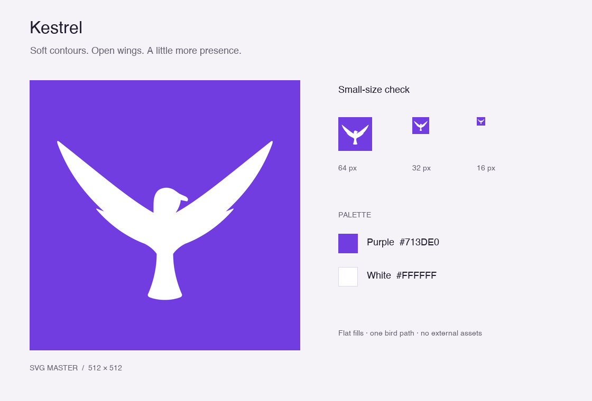

> The reference-based, smoothed design was approved for app integration on 1 October 2026. Current source artwork and regeneration instructions are in [`resources/branding`](../../../resources/branding/README.md). The concepts below are historical explorations.

# Kestrel logo concept

An original, editable SVG: a white kestrel silhouette with raised, outstretched wings on a flat purple square.

The follow-up exploration contains [five alternative logos and their design references](alternatives/README.md), with a [side-by-side comparison](alternatives/five-directions.png).



- [Vector master](kestrel-logo.svg): 512 × 512 viewBox, one background rectangle and one filled bird path.
- [Large PNG preview](kestrel-logo-preview.png): 1024 × 1024, rendered from the SVG with macOS Quick Look.
- [Visual review sheet](kestrel-logo-review.png): large preview alongside native 64, 32 and 16 pixel renders.
- Colours: purple `#713DE0` and white `#FFFFFF`. No gradients, strokes, embedded bitmaps, external assets or fonts in the SVG.

The tapered wings and shallow feather notches keep the mark simple. Rounded wing tips, a softer beak, a smooth body contour and a gently fanned tail give it a friendlier feel. The silhouette is scaled up by 20% from the first concept and spans about 80% of the square's width. The square background has hard corners so the artwork can be used directly or masked by a consuming surface.

## Visual verification

Rendered and inspected on macOS on 30 September 2026, including the user's requested friendlier, larger revision. The large version has smooth contours, balanced wing spacing and clear margins. The silhouette remains legible at 64 and 32 pixels. At 16 pixels the overall wing-and-tail shape remains recognisable, while the beak and feather detail naturally reduce.

XML structure, flat fills, self-contained vector content, image dimensions and whitespace checks passed. This is a standalone design concept in the `logo-build` worktree. The application's icon catalogue and `.icns` resource have not been replaced, and no application build or runtime verification is claimed for this artwork-only change.

To reproduce the native preview from the repository root:

```bash
mkdir -p /private/tmp/kestrel-logo-review
qlmanage -t -s 1024 -o /private/tmp/kestrel-logo-review docs/branding/logo-build/kestrel-logo.svg
```
