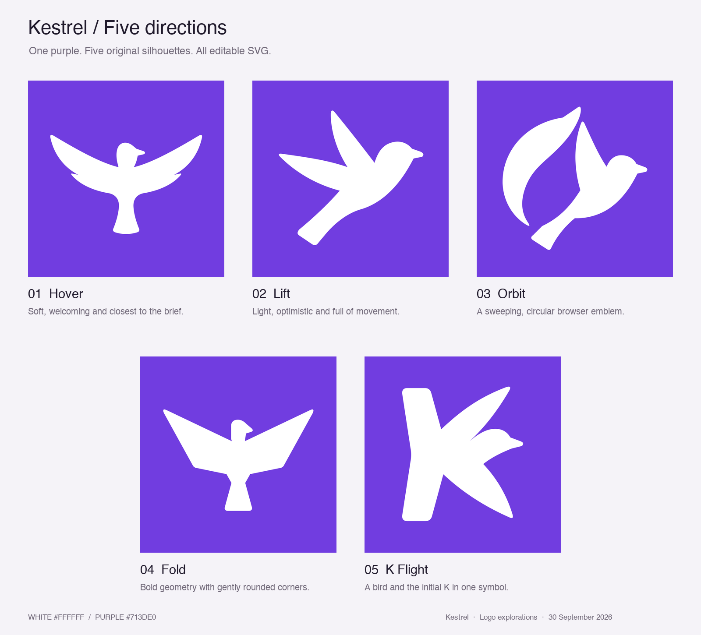

# Five alternative Kestrel logos

Five original vector interpretations of the brief: a solid purple square, a minimalist white kestrel with outstretched wings, a friendly outline and a generous footprint. All use `#713DE0` and `#FFFFFF` so the shape is the main comparison.



| SVG master | Design direction | Design reference |
| --- | --- | --- |
| [01 — Hover](01-hover.svg) | Broad, gently raised wings, rounded feather tips and a soft tail. The closest option to the original brief. | The approachable, rounded character shapes seen in [Duolingo's design work](https://blog.duolingo.com/hub/design/). |
| [02 — Lift](02-lift.svg) | A side-on bird climbing diagonally, with two sweeping wings and a long tail. Light, clear and optimistic. | The economical silhouette and sense of flight in the [Lufthansa Group mark](https://www.lufthansagroup.com/en/company.html). |
| [03 — Orbit](03-orbit.svg) | A banking bird with a separate sweeping wing, creating an open circular emblem. The most expressive browser-oriented option. | The circular animal composition visible in [Firefox's official brand portal](https://brand.mozilla.com/d/5UkPdpbtt8LS). |
| [04 — Fold](04-fold.svg) | Broad geometric wing planes and a compact tail, with softened corners. A more structured corporate mark. | The bold geometric animal treatment in [Brave's branding](https://brave.com/brave-branding-assets/). |
| [05 — K Flight](05-k-flight.svg) | An abstract bird whose wings, body and tail suggest the initial K. The most distinctive monogram direction. | Compact letter-based identity and restrained purple branding in [Proton's media kit](https://proton.me/media/kit). |

These are design interpretations from visual research, not claims about the companies' design rules. The official pages and their visible marks were inspected through BrowserOS neo on 30 September 2026. The paths were drawn for Kestrel; no corporate artwork or SVG paths were imported.

## Recommendation

**02 — Lift** offers the strongest balance of friendliness, movement and a clear bird silhouette. **05 — K Flight** is the strongest alternative if a distinctive lettermark matters more than a literal kestrel. **01 — Hover** stays closest to the requested frontal, outstretched pose.

## Files and visual checks

Each numbered SVG has a matching 1024 × 1024 PNG preview. The SVGs are self-contained, with a 512 × 512 viewBox, a solid background rectangle and one white filled path. Orbit uses two separate contours inside that path. There are no gradients, strokes, fonts, scripts, external resources or embedded bitmaps.

[Native size checks](size-checks.png) show separate macOS Quick Look renders at 64, 32 and 16 pixels, including a nearest-neighbour enlargement of the 16-pixel render. All five were also inspected at large size. The main silhouettes remain clear at 32 pixels. At 16 pixels the finer beak and feather features reduce; Orbit's narrow separation becomes softer. Lift and K Flight retain particularly clear overall shapes.

The circular draft was refined to remove a near-touching wing/tail junction; Fold was simplified to solid wing planes. XML structure, exact fills, preview dimensions and unclipped image margins were checked. This is artwork-only work in `codex/logo-build`; it does not change the shipped app icon or claim app build/runtime verification.

To reproduce previews from the repository root:

```bash
mkdir -p /private/tmp/kestrel-logo-alternatives
qlmanage -t -s 1024 -o /private/tmp/kestrel-logo-alternatives docs/branding/logo-build/alternatives/*.svg
```
